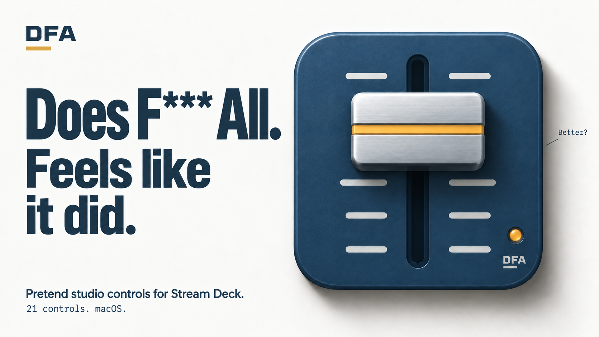
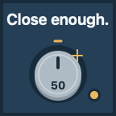
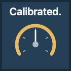

# DFA

Does F\*\*\* All. Feels like it did.

[](https://austinpresley.github.io/DFA-Streamdeck/)

The engineer moves an unconnected fader. "Better?" "Perfect."

DFA is that fader, with 20 more ways to look helpful. A Stream Deck plugin
with blue enamel, silver hardware, tiny amber lamps and a very serious
commitment to changing absolutely nothing in your mix.

**[Play with DFA](https://austinpresley.github.io/DFA-Streamdeck/)** ·
**[Download for Mac](https://github.com/austinpresley/DFA-Streamdeck/releases/download/v0.5.0/DFA-0.5.0.0.streamDeckPlugin)** ·
[Release notes](https://github.com/austinpresley/DFA-Streamdeck/releases/tag/v0.5.0)

## Please press the buttons

| Fix it | Make it pop | Talent |
| :---: | :---: | :---: |
|  |  |  |
| A brief repair. A decisive "Fixed." | A spring-loaded answer to that request. | One official unit. You're welcome. |

| Perfection | Client approval | Calibrate |
| :---: | :---: | :---: |
|  |  |  |
| Polish. Inspect. Close enough. | Nothing changed. Everybody wins. | To no known standard. |

These are actual native key renders. The [website](https://austinpresley.github.io/DFA-Streamdeck/)
lets you try six keys and a fader, with sound when you enable it.

## The whole collection

21 controls on keys. Seven also work on Stream Deck + dials.

| Control | The performance | Dial |
| --- | --- | :---: |
| DFA fader | An imaginary monitor level. "Better?" | ✓ |
| Fix it | A repair ceremony. "Fixed." | |
| Calibrate | Measure, align and verify nothing. | |
| More | More of what is never established. | ✓ |
| Warmth | An imaginary tube, all the way to "Toasty." | ✓ |
| Less | Independent of More. Both can reach 100. | ✓ |
| A/B | Two identical settings. "Hear that?" | |
| Sweet spot / Flux alignment | Two needles meet. "There." | ✓ |
| Fine tune / Second opinion | A careful journey back to the start. | ✓ |
| Client approval | One very authoritative rubber stamp. | |
| Confidence | At 100%, officially unwarranted. | ✓ |
| Blame | Cable. Room. Source. Previous engineer. | |
| Bypass | Disconnect the already disconnected. | |
| Executive override | Open the guard. Authorize nothing. | |
| Make it pop | A spring cap does exactly what you asked. | |
| Glue | Two blocks. One convincing clunk. | |
| Remove mud | Drain a little inspection window. | |
| Unnecessary reboot | Its own tiny screen powers down and back up. | |
| Busy doing nothing | Progress. Second thoughts. Completion. | |
| Talent | One printed unit of talent. "You're welcome." | |
| Perfection | A fixed dial gets polished. "Close enough." | |

Each placed control saves its own label, main color, accent color, sound,
volume and reduced-motion settings. Value controls offer 1-point or 5-point
steps. There are eight original short sounds. Sound changes DFA's own volume.

## Install

1. [Download DFA 0.5.0](https://github.com/austinpresley/DFA-Streamdeck/releases/download/v0.5.0/DFA-0.5.0.0.streamDeckPlugin).
2. Double-click the `.streamDeckPlugin` file and confirm in Stream Deck.
3. Drag a control from the DFA category onto a key or supported dial.
4. Nod thoughtfully.

macOS 13+ and Stream Deck 6.5+. Developer ID signed, Apple-notarized and built
for Apple silicon and Intel. Be online for the first launch's Apple ticket
check. [Install guide and troubleshooting](INSTALL.md).

## Public preview

The unchanged 0.5.0.0 installer has passed software checks, native simulation,
stress checks and scenario replays against the real executable. Physical
installation, listening, key/dial feel, profile changes and reconnects remain
unverified. The Intel slice and oldest supported macOS have not been run.
This release is a public preview while those checks remain pending.

Installer SHA-256:

```text
4bb5cd53566d0fff73db784431f3d827cd24e379f642b729b261c50e307218d4
```

## A very firm boundary

DFA changes its own display, bundled sounds and preferences. It has no mixer,
MIDI, OSC, system-volume, keyboard-automation or app-control effects. No account,
analytics or runtime internet connection. The first-launch Apple security
check is separate.

## About this repository

This is the public website and binary-download home. DFA's original plugin
source stays private. Official binary releases are free to install and use;
the original code, artwork and sounds remain proprietary. See [LICENSE](LICENSE)
and [third-party notices](THIRD_PARTY_NOTICES.md).

Made with unnecessary care by Austin Presley.
